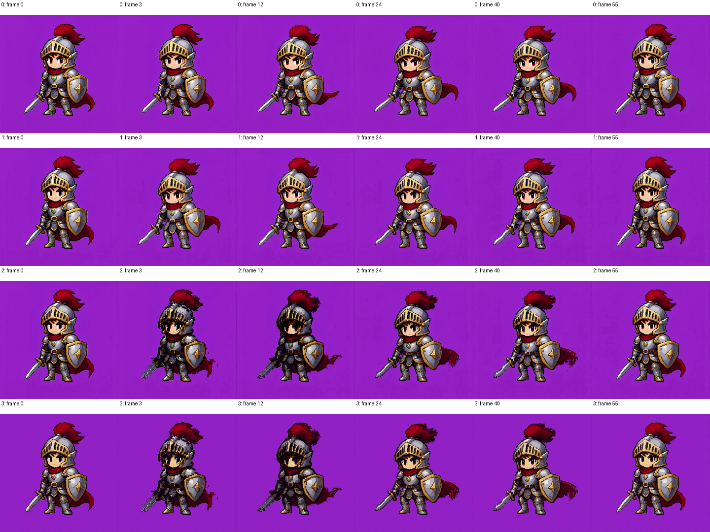

# AI 像素视频后处理重构方案与审查标准

日期：2026-09-26。本文保留最初的设计与验收提案。用户随后授权本任务亲自实施，当前已完成视频 v2 的规则网格、当前帧采样和保守静态区域时序；实际结果、偏离提案之处与验证范围见 [实施报告](VideoPipelineV2Results.md)。下文中的“本轮”指最初的设计阶段。

## 1. 决策摘要与范围

建议重构视频路径：以**当前帧的空间重建为基准，只在可信对应区域施加有限的时序约束**，替代目前“单帧不规则网格 + 各帧独立聚类 + 固定坐标颜色众数”。先建立无拖影的空间基线，再证明时序模块确实改善闪烁；不要先上复杂光流模型。

优先级：帧身份正确、运动轮廓与新显露区域正确 > 无新增黑影 > 像素轮廓与小细节 > 静态区域低闪烁 > 速度。不能通过冻结角色、抹掉剑尖或降低动作幅度来换取低闪烁。

本次保护边界：

- 不改变 `PixelGridRestore`、`PixelPaletteExtract`、`PixelPaletteApply`、`PixelExportScale` 的图片行为及默认参数。
- 不修改共享的 `grid_restore.py`、`_palette_utils.py`、`_image_utils.py` 来迁就视频；视频算法放在视频所有者模块中，可调用不变的底层工具。
- 不改 ComfyUI 核心，不增加模型下载或网络请求，不更改生成模型，不尝试生成式补画。
- 保持 `PixelVideoGridRestore` 节点 ID、原有九个输出的类型和顺序；保留音频、帧数和图内精确帧率契约。视频内部重构不要求像素结果与旧算法一致。
- 仓库已有大量暂存和未暂存改动。实施从**当前工作区**建立基线，不能用 HEAD 覆盖这些改动。本轮只新增本文和证据目录。

## 2. 实查证据与结论边界

实际目录为 ComfyUI 的 `output`，用户所写的 `outputs` 不存在。本轮检查文件元数据，解码并抽查了以下四个视频的第 0、3、12、24、40、55 帧（均为零基索引），没有将抽帧检查冒充完整实时播放验收。

| 联系表行号 | 文件（相对 output） | 分辨率 | 帧数 / 帧率 |
|---|---|---|---|
| 0 | `video/MiniMax_H3_00008_.mp4` | 736×736 | 56 / 24 |
| 1 | `h3_08_ps3_nopal_tw0.mp4` | 1452×1464 | 56 / 24 |
| 2 | `h3_08_nopal_ps3.mp4` | 1452×1464 | 56 / 24 |
| 3 | `h3_08_pixel_ps3.mp4` | 1452×1464 | 56 / 24 |



可见行 2、3 在第 3、12 帧有明显盔甲/脸部暗区扩大、剑与披风重复轮廓；行 1 明显较干净。第 12 帧整幅图 `max(R,G,B)<50` 的像素占比：原视频 4.59%，标注 tw0 的版本 4.59%，nopal 版本 10.49%，palette 版本 10.79%。这是解码图像的描述性统计，**不是**分割后的黑影指标；尺寸、编码、量化不同，不可据此断言全部差值由一个参数导致。

派生的 `h3_08_*.mp4` 没有保存处理 prompt/workflow；文件名暗示实验条件，但无法核实 `temporal_window`、采样、缩放、所用代码版本。`MiniMax_H3_00008_` 有生成工作流元数据，未发现 Pixel 节点。它与派生片视觉内容一致，但来源关系仍须实施 Agent 用原输入重新生成来锁定。

证据文件：

- [samples.json](video-review-2026-09-26/samples.json)：尺寸、帧数、抽帧统计。
- [helper-proof.json](video-review-2026-09-26/helper-proof.json)：现有时序纯函数的最小复现。
- [baseline.json](video-review-2026-09-26/baseline.json)：本次代码和四个视频 SHA-256，用于锁定审查基线。

本轮没有执行整套 ComfyUI 节点测试。ComfyUI 的 venv 解释器无法启动其引用的 Python；改用另一个本机 Python 环境完成 OpenCV 解码、NumPy 纯函数验证和证据输出。运行环境问题不能被写成节点测试通过。

## 3. 根因分层

以下行号对应本轮工作区，后续优先按函数名定位。

### A. 已确认：固定坐标众数有颜色偏向，也没有运动对应

位置：`nodes/video_grid_restore.py::_temporal_mode`（约 200 行），以及 execute 约 711 行。

当前把 RGB/RGBA 打包成整数，在 `[t-k,t+k]` 的同一网格位置上取众数；平票选择最小整数。真实视频受到压缩、光照和抗锯齿影响，邻帧精确 RGB 常常全不相同，此时操作接近**时间窗口内按 RGB 字典序取最小值**。它不是亮度最小值，但黑色、低 R 色常有优势。

本轮从源码 AST 取出现有 `_pack_keys`、`_unpack_keys`、`_temporal_mode` 执行，灰度序列 `[220,100,10]` 在 `k=1` 后成为 `[100,10,10]`。颜色虽然来自窗口，却不代表属于当前时间、当前物体或当前位置。深色轮廓可在运动路径上向前后扩散；未来帧参与还会产生预先出现的影子。

即使改为“平票保留当前帧”，窗口中真实占多数的旧背景/旧轮廓仍会压掉短暂动作。**只改平票规则不是最终解法**。当前默认窗口为 0，故此机制只解释启用窗口后的损伤；不能解释所有 tw0 问题。

### B. 已确认：参考帧位置与原始帧号混用

位置：execute 约 625–629、669 行。

`ref_pos = len(probe_rgb)//2` 是采样数组的位置；`ref_rgb = probe_rgb[ref_pos]` 对应原始帧 `sample_idx[ref_pos]`。循环却在 `frame_index == ref_pos` 时直接复用参考帧结果。

56 帧、stride=8 时，采样帧为 `[0,8,16,24,32,40,48]`；实际参考帧是 24，却把它的结果写入输出第 3 帧。即使 `temporal_window=0` 也有一次错误跳帧；开启窗口可将异常传播到邻帧。这是源码确定性缺陷，但不能证明历史视频由同一版本产生。

修复要求：明确 `reference_frame_index = sample_idx[reference_sample_position]`，或去掉这项复用优化。测试须直接证明每一帧的身份正确；“重复运行相同”“不同 chunk 相同”都抓不到这个错误。

### C. 结构性风险：把 AI 视频当作存在精确、静止的原生网格

`_detect_grid_for_clip` 先平均 RGB 再检测。移动网格相位可能被平均抵消，平均画面也可能造出虚假周期，不能假定移动内容模糊后必然强化网格。当前一旦返回尺寸就接受，confidence 仅报告，不控制低置信度路径。

`_refine_once` 在一张中间帧上根据内容吸附每条网格线，并沿整段复用。这样锁住了输出尺寸，却把该帧的物体边缘误差锁进了所有帧。输入 736×736、输出 1452×1464 的已有例子也提醒我们：需要把目标网格和内容吸附分开；仅凭编码尺寸无法反推精确细格数或断言具体参数。

相机运动不等于需要移动输出网格：输出像素画布应固定。首先重建当前帧在固定目标画布上的内容；不要跟着人物移动整个网格，也不要将所有帧稳定到中间姿态。

### D. 待实验证明：格内颜色竞争与调色板跳变

固定种子只能保证同一输入可重复；略有变化的格内两簇面积仍可能翻转，`Majority Cluster` 在边缘会从背景突然切换到黑色轮廓。必须用 center/现有 majority/新空间采样消融确认，不能把种子视为时序稳定性保证。

当前 `extract_palette` 对整批合并提色，**不是默认每帧一套色板**。不应以“修复逐帧提色”为理由重写图片提色器。共享色板的最近色映射仍有决策边界闪烁，低色数也会吞掉高光；但 nopal 视频同样出现黑影，色板不是唯一根因。视频默认先关抖动。

### E. 视频契约风险，顺带纳入审查

- execute 只从 `components.images` 取 alpha，没有接收单独的 `components.alpha`；文件读入透明视频的 mask 会丢失。
- RGBA 混合透明/不透明帧时，缺失 alpha 的替代 `opaque` 带整个 T 维，放入逐帧列表可能导致 stack 形状不一致（约 701 行）；应补单帧 `[h,w,1]`，验证真实返回 None 的分支。
- 处理先转 uint8，之后转发 HDR/高 bit depth 元数据不等于保存原动态范围。此次质量目标限定 SDR；不能声称 HDR 无损。对 HDR 给出明确限制，不暗中加未经定义的色调映射。
- yuv420p 和再次编码会改变像素颜色，但不足以独立解释当前未对齐时序的严重黑影。像素级验收必须在编码前；实际播放另验编码后结果。

## 4. 目标数据流

```text
VIDEO → 读取当前帧/音频/帧率/alpha
      → 确定整段统一目标网格尺寸；检测镜头切换
      → 每帧规则格内空间采样（独立、确定、当前帧候选）
      → 可选：可信区域的非递归时序候选选择
      → images + video（既有接口）

images → 既有整批提色/应用固定色板 → nearest 整数放大
       → 既有 CreateVideo/SaveVideo
```

第一轮不改变下游图片节点。若完成前端后，**量化后的**闪烁仍明显，才评估视频专用色板标签稳定阶段；不要在前端和量化后同时叠加两个未经消融的时序滤波器。

### 4.1 目标网格：固定规则格优先

1. 手动 `By Grid Count` 为确定性金标准：输出严格为指定 `grid_w×grid_h`，使用浮点边界 `x_i=iW/grid_w`、`y_j=jH/grid_h`。覆盖全画布，不丢边缘；不因 refine 或 fix_square 改数量。
2. `By Pixel Size` 沿用可解释的 `round(W/p), round(H/p)`（下限 1），报告最终尺寸和两个方向实际间距。空间采样须处理非整数边界，禁止先舍入边界导致空格。
3. Auto 在**各采样帧的梯度投影/归一化频谱证据**上聚合，不平均 RGB。去除低纹理和淡入淡出帧的无信息贡献；以成对 `(pitch_x,pitch_y)` 候选及置信权重聚类，检查基频/二倍频歧义，不能独立取 x/y 中位数拼出不存在的候选。
4. 用确定性的均匀抽样，包含首尾，建议最多 32 帧；逐帧计算统计，不保留所有全分辨率探测帧。32 为起始预算，须记录采样索引。
5. 没有可信周期时按显式 `fallback_pixel_size` 构造规则格，报告 `detected=False`、低 confidence 和一次简短提示；建议初始默认 8，仅为输出风格尺度，不声称“真实像素尺寸为 8”。对本片扫 3/4/6/8/12/16，以同一展示尺寸人工比较脸、剑尖、披风。不要把 16 固化成所有 AI 视频的最佳值。
6. 整段输出分辨率保持一致；镜头切换重置时序状态，不允许在同一 IMAGE batch 中改变尺寸。不同镜头需要不同输出粒度时，由用户分段处理。

第一版规则格相位为画布原点。全局相位估计仅在真实上采样像素片被证明存在偏移时追加，并保持全片固定、明确边缘覆盖规则；不逐帧吸附每条格线。`refine_intensity/fix_square` 的迁移见接口章节。

### 4.2 空间采样：结果必须有当前帧支持

先保留现有三种 sampling 作为可选对照，视频增加一个确定性 `Robust Cell` 方案，待实验通过后设为新节点默认。

建议实现起点：

- 每格取中心和固定对称位置，最多 5×5 个样本；小格去重后可用所有原像素。位置按连续格边界计算，取有效像素，不用零填充。
- 中心附近赋较高空间权重。用真实 Lab 色差计算候选的加权截断距离总和，选择**实际样本色**的 weighted medoid，避免逐通道拼色。候选数固定时成本可控，不能做全分辨率每格任意多点 O(n²)。
- 同时记录最优候选与中心候选的代价、支持率、局部梯度，供时序门控使用。平票优先中心、再固定空间索引，不按颜色值大小打破平票。
- 细线/小高光可能被 medoid 吞掉，因此保留中心候选，使用合成一像素线、眼睛、高光验收；若 robust 失败就以 Center 为该版本默认，不能靠跨帧复制“补回”细节。
- 有 alpha 时使用可见度权重，透明像素的隐藏黑色不参与 RGB 决策；alpha 从当前帧按明确覆盖规则采样。首版不做跨帧 alpha 稳定，避免透明边缘拖尾。

此处的权重、截断色差阈值需要小规模扫参；不得写成已经验证的最优常量。中心采样与 weighted medoid 的比较必须保持输出尺寸一致。

### 4.3 时序：可关闭、非递归、拒绝不可靠历史

**Off 必须是完整可交付方案。** 移除运行路径中的旧 `_temporal_mode`。先实现静态区域限定策略，再考虑运动补偿，不一次叠加多种算法。

静态限定版本：利用未滤波空间结果与低成本源帧 patch 比较，只有当前与前后邻居的颜色、梯度、局部结构一致时才能稳定。大残差、边缘变化、镜头切换、一帧短动作均保持当前结果。仅有“差值小”不足以证明静止，运动轮廓需要保守扩张一格的禁用带。此版宁可保留运动区域闪烁。

运动补偿版本仅在静态版质量不足时进入：

1. 在未量化的源帧代理分辨率上估计相邻帧双向光流（优先现有 OpenCV Farneback；不新增 RAFT 模型）。代理尺寸建议长边至多 512，但不能小于目标格密度所需的有效尺度；记录实际缩放。
2. 明确流的方向：从当前位置 x 用 `F(t→s,x)` 找邻帧位置。前后向一致性用 `||F(t→s,x)+F(s→t,x+F(t→s,x))||`，统一单位为代理像素；映射到源/网格时显式缩放。
3. 门控联合：越界无效、前后向误差、warp 后光度残差、局部结构差、局部流梯度和遮挡/新显露判定。低纹理置信不足时保持当前，不以“小流”当成可信证明。cut 两侧永远不借帧。
4. 运动仅用来建立候选对应与置信度。双线性可用于匹配评分，不能将插值后的历史 RGB 直接混入输出；离散候选/标签对应使用最近邻，并标记无效区域，禁止边界零填充成为黑色候选。
5. 首版只看 `t±1` 的**未时序处理结果**，绝不把处理后的上一帧递归喂回。扩到半径 2 需要单独证明收益；不沿用旧半径 8 的默认理解。
6. 输出从当前格的候选集中选择。候选 c 的代价为 `D_current(c) + λ·Σ valid·q·ρ(ΔE(c, neighbor))`；D 是当前格空间支持代价，q 为对应置信度，ρ 为截断惩罚。平票保留当前空间最优。候选不可凭历史凭空加入。
7. 硬门槛：候选与当前最优的当前帧代价差超过容差就禁止替换；所有历史无效时**逐字节返回空间基线**。λ=0 必须等同 Off。时序总影响设置上限，不允许邻帧数量覆盖当前证据。

切镜头先用全局色彩/结构变化筛选，再结合对应失配比例；单独直方图会漏掉相近配色的切换。误判为切换只减少稳定，漏判会产生拖影，应向前者取舍。阈值用合成 cut、闪光、淡入淡出和真实片校准并记入报告。

### 4.4 调色板与输出

首版继续一段视频共用既有提色结果，抖动 Off；不修改图片提色器。用户色板必须原样使用。视频专用后续优化可按整段均匀抽样提色并保护稀有强调色，但须另行实验证明，不按 chunk 生成色板。

若最近色标签切换成为主要剩余问题，视频专用标签阶段使用固定色板，当前帧最近/次近色为候选，历史只在当前色差近似平局且对应可信时作为有限惩罚；绝不无条件保持上一帧标签。应以独立视频节点或明确的视频路径实现，不能偷偷改变 `PixelPaletteApply` 对 IMAGE batch 的含义。此阶段属于后续可选范围，提交前先审查接口提案。

最终 nearest 整数放大；保存前对 tensor/PNG 检查色板成员关系，编码后检查块边界、播放、音画同步。CreateVideo 浮点 fps 与直接 video 的 Fraction 路径分别验收，不能宣称 float 路径精确保留 30000/1001。兼容现有编码器，不把要求改核心编码器作为此次前置条件。

## 5. 实施拆分与兼容策略

| 阶段 | 主要工作 | 进入下一阶段的条件 |
|---|---|---|
| P0 纠错与基线 | 正确参考索引；建立帧身份/移动轮廓测试；现有流程 tw0 与启用窗口对照；alpha 边界修复 | 不丢帧、不串帧；照片路径基线未改变 |
| P1 视频空间核心 | 规则网格、当前帧确定性采样、Auto 证据聚合及可解释 fallback；移除旧时序执行路径 | Off 在真实样片上没有新增黑影；细节与形状达到审查要求 |
| P2 保守时序 | 先静态限定；必要时才做双向运动对应和候选代价 | 对 Off 有可测闪烁收益，且运动轮廓和短动作不退步 |
| P3 接口与交付 | 工作流迁移、视频文档/中文提示、诊断和性能报告 | 所有硬性门槛通过，真实视频人工审查通过 |

建议新增一个私有 `nodes/_video_utils.py` 承载纯算法，`video_grid_restore.py` 负责节点编排。不要搭插件式策略框架；算法还小时也可先放原视频文件。更新 `_selftest.py` 的视频部分或新增专门视频测试文件，不改图片测试期望来掩盖回归。

兼容原则：

- 新增参数采用可缺省的输入。新节点默认 Off；`grid_mode` 三个已有值不改名，不能通过重排 DynamicCombo 静默改变旧工作流含义。
- 原 `sampling` 三个值继续有实际对应算法。`Robust Cell` 只在验收通过后成为新建节点默认。
- `temporal_window=0` 继续表示 Off；旧非零值迁移为保守时序的有效半径，并明确提示算法已替换。初版仅支持半径 1 时，将旧大窗口明确归一化并记录，不能继续调用旧 mode，也不能保留一个 UI 可调却永远不读取的参数。
- `refine_intensity/fix_square` 与严格规则格语义冲突。实施者应提供**可执行的旧工作流迁移**（备份 JSON 后移除/转换旧字段），新 schema 移除这两个视频选项；不要在运行期保留无效旋钮。验证一份真实旧工作流在前端打开和执行，特别防止位置型 widgets_values 错位。无法安全迁移时暂保留旧 schema 的 P0 版本，不能草率发布 P1 schema。
- 若新的算法需要在 P2 发布前承接非零旧窗口，可用静态限定策略；不能先挂一个尚未实现的 Motion 选项。
- 原 confidence 输出保持 float，但新含义明确为检测证据置信度，非质量分或概率。Auto fallback 时 detected=False。将真实 grid、fallback 原因、cut 帧号、有效匹配比例写入可选本地诊断，默认日志仅简短摘要。

内存：分块只降低转换和光流中间量，`get_components()` 的整段输入和最终 IMAGE batch 仍常驻。统计采样预算固定，流只缓存相邻帧，窗口需要跨 chunk halo；任何 chunk 大小下结果一致。不得缓存全片全分辨率流场，或声称已实现解码流式处理。CPU 路径优先，不强加新的 GPU 依赖。

## 6. 验收实验与禁止通过的方式

### 6.1 固定真实片与消融矩阵

以证据目录 hash 锁定本次四个文件；从确认的原片重新生成实验，保存参数、代码 hash、运行环境、输出 grid、处理时长和峰值内存。至少补充 `MiniMax_H3_00009_` 与 `h3_t2v_base_00001_`，先确认内容，再覆盖快速局部运动、纹理背景、相机平移和镜头切换；缺失的情形用合成片补足。

最小实验序列：

1. 原视频、当前旧实现 Off、旧实现窗口 1/2（仅作失败对照）、修正索引后的 Off。
2. 同一 grid、同一放大倍率，比较现有 majority、center、新 Robust Cell。
3. 同一空间输出，比较 Off、静态限定、Motion（若实施）；每种都保存编码前帧。
4. 固定色板与关闭色板各一组；最后才对照输出编码。不能同时改网格、色数、时序、编码再归因。

展示用统一画布尺寸并标注原始网格数，算法结果不为做对照而进行双线性缩放。需正常速度循环播放和 0.25× 慢放，重点看第 2–5 帧、第 10–14 帧，以及完整披风往返动作；联系表只能辅助。

### 6.2 合成测试：有 ground truth 才能判运动对错

| 测试 | 必须验证的性质 |
|---|---|
| 每帧不同且可识别的颜色/编号块，T=56、stride=8 | 输出 t 只来自输入 t；尤其第 3 与 24 帧，Off 与各 chunk 下都正确 |
| 黑色单像素线/方块在浅底移动 1/2/4 格 | 不出现旧位置黑影或提前出现；快速运动也不复制历史 |
| 反色版本与等亮异色版本 | 不存在“暗色/低 R 优先”偏向 |
| 一帧闪光、眼睛高光、剑尖瞬间出现 | 不以众数删掉真实短暂内容 |
| 前景离开露出背景、两物体交叉遮挡、移出边界 | 新显露区域当帧恢复；越界无效不注入黑色 |
| 静态像素画叠加可控噪声 | 稳定收益来自降低噪声，不能抹掉干净结构 |
| 相近色切镜头、硬切、淡入淡出 | 跨镜头候选数为零；淡入不残留旧轮廓 |
| 奇数尺寸、非整数格宽、矩形画布、1/2 帧视频 | 尺寸固定、全覆盖、无空格、正确首尾处理 |
| RGBA、alpha slot、全透明与全不透明交替 | RGB/alpha 对齐、形状正确、黑底/白底合成无新增黑边 |
| chunk=1/3/12/0、重复执行、CPU | 编码前结果一致；不依赖上次执行状态 |

旧 `_selftest.py` 验证“结果等于旧众数规则”“首帧异常变黑”等测试应被删除或替换为用户可见正确性测试；保留错误规则的自洽性不是验收。

### 6.3 指标与判定

硬性门槛（无需主观解释）：帧数/顺序正确；图内原 Fraction 和音频数据保持；每帧尺寸一致；无 NaN/越界；Off/λ=0 与空间基线逐字节一致；无有效邻帧时逐字节回退；无跨 cut 取样；chunk 不改变输出；图片基线 byte/hash 和原测试不变。

运动质量指标：

- 在无噪声、格对齐的合成片上，GT 当前背景中多出的前景/暗色像素为 0；遮挡结束后拖尾持续帧数为 0；质心位置误差为 0 格。若采样器本身不满足，先修空间基线，不能放宽时序测试。
- 在带噪或亚像素运动片上，与 Off 使用相同 grid 比较：分别报告轮廓 IoU、95 分位边缘距离、当前 GT 背景里的残影率、动作幅度和延迟；所有指标必须不劣于预先确定的容差。不得用对 GT 时间重对齐隐藏延迟。
- 闪烁只在已知静止区域或独立 GT 运动补偿后的有效区域计算，例如相邻帧 ΔE 均值/95 分位或固定色板标签翻转率；不能直接全图相邻差，也不能仅使用算法自己的置信 mask 排除失败区域。
- 建议 P2 在可控噪声静态区域至少降低 20% 闪烁，且不增加上述合成残影、延迟和细节丢失。20% 是提案验收目标，未达标就保持 Off 为默认，不为追分扩大时间窗口。

真实片没有干净 GT：采用固定 ROI 的盲标 A/B，审查脸/盔甲黑区、剑尖/高光、披风边缘和背景。当前 tw0 仅为现有较好参考，不充当真实 GT。P2 若只让静态背景好看却让披风变差，不通过。

性能记录：同机器 56×736² 与 124×768²，记录输入准备/空间/匹配/输出各段时间、峰值 RSS 与可选 VRAM，注明是否含解码编码。初始预算建议：P1 时间不超过旧 Off 的 1.5 倍、额外峰值内存不超过旧 Off 的 1.25 倍；P2 时间不超过 P1 的 2 倍。若超出，先报告与优化或保持为显式可选模式，不能默认为已满足。质量硬门槛优先于速度。

## 7. 实施 Agent 交付物与后续审查

每阶段提交一份可单独评审的改动说明：解决的问题、修改文件、精确参数、测试输出、对照视频/编码前关键帧、已知剩余问题。真实视频参数与 code hash 必须随结果保存，补上现有样片无法复现的缺口。

审查按以下次序进行：

1. **范围审查**：只改视频路径；图片源码与基线未动；没有覆盖原有用户改动。
2. **正确性审查**：索引、尺寸、alpha、fps/audio、边界/cut/chunk、旧工作流迁移，先于看漂亮截图。
3. **算法审查**：运动对应方向/单位正确；当前候选支持、回退和代价上限真实生效；没有递归历史污染、RGB 时间平均、旧众数或黑色 padding。
4. **视觉审查**：完整播放与关键 ROI，无新增黑影/拖尾/提前影子；真实短动作和细节保留。审查者可要求退回上一阶段，不能以“所有单测通过”替代观看视频。
5. **性能与交付审查**：报告可复现、参数完整、接口和文档同步，图片全套回归通过。未验证项明确列出，不写“全部完成”。

建议实施入口：先完成 P0 并交付对照，不在第一个补丁里同时换网格、采样器、光流和色板。最终允许大幅替换视频核心，但每个复杂度增加都要有消融证据。后续由本设计任务按以上检查表审查实施结果；本轮没有创建或指挥其他 Agent，也没有实现新算法。
