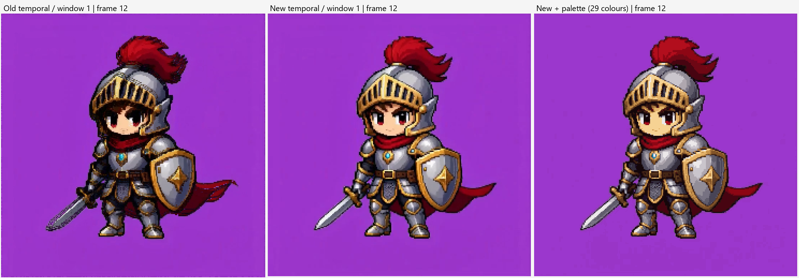
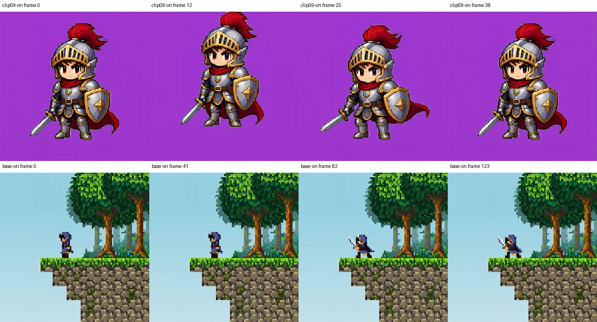

# 视频 v2 实施与验证报告

2026-09-26。按用户后续授权，已在当前工作区实现视频核心重构；未提交 Git、未重启正在运行的 ComfyUI。

## 可以直接查看的结果

- [旧时序 / 新时序 / 新时序加色板：并排视频](video-v2-results/comparison.mp4)
- [新版视频](video-v2-results/restored.mp4)
- [新版加固定色板](video-v2-results/restored-palette.mp4)：请求上限 32 色，既有提色器去重后得到 29 色，编码前色板成员关系已验证。
- [完整参数、输入和算法代码哈希、性能记录](video-v2-results/measurements.json)
- [交付视频探测信息与最终源码哈希](video-v2-results/final-verification.json)

## 实际实现

- `nodes/video_grid_restore.py`：去掉参考帧替换、单帧不规则网格细化和跨帧众数；统一规则格，按顺序逐帧处理。
- `nodes/_video_utils.py`：有界九点采样、可见度加权的 Lab medoid、逐帧边缘频谱与成对网格共识、可信静态区域的当前候选选择。
- 时序不会借用历史 RGB。候选必须属于当前帧格子，且限制空间代价增加和色差；原始格内样本变化、轮廓、切镜头、半透明区域会关闭时序证据，并向周边扩展保护区。输入始终是未滤波结果，没有递归反馈。
- 透明度读取支持 RGBA 和独立 alpha slot，修复原来丢 mask 和混合透明度帧的形状问题；保留原图内 Fraction、音频对象和帧顺序。
- 旧节点 ID、九个输出与原三种 grid_mode 保留。前端扩展迁移旧视频 widget 和被移除输入的连接；中文版参数说明同步更新。

图片节点与共享算法的 SHA-256 和实施前快照一致，包括 `grid_restore.py`、`palette.py`、`_palette_utils.py`、`_image_utils.py`、`export_scale.py` 和 `nodes/__init__.py`。没有使用 HEAD 覆盖用户已有改动。

## 与最初提案的取舍

首版完成 P0、P1、保守静态版 P2 以及文档/迁移。没有实现光流：当前静态策略已消除旧众数造成的大幅暗影扩张，并通过运动回归；运动区域宁可保留少量闪烁。也没有增加第二个视频调色板节点，现有整批提色及应用链在真实视频上已能正常工作。

九点采样替代提案允许的最多 25 点，控制计算量；保留 0–8 的有效时序半径，但每一跳都必须连续通过稳定区域判断，避免保留一个不生效的旧旋钮。`peak_width` 在视频中的新含义是最少重复格数，文档与 UI 已标明。

## 实测结果

主对照输入：`output/video/MiniMax_H3_00008_.mp4`（相对 ComfyUI 根目录），736×736，56 帧，24 fps。
旧版从实施前工作区快照加载；与新版使用同一解码来源。固定 pixel_size=3；旧版 refine=0、fix_square=False。

| 条件 | 输出网格 | 处理耗时（不含解码、编码） | 额外峰值 RSS | 第 12 帧暗像素占比 |
|---|---:|---:|---:|---:|
| 旧版 Majority，时序关 | 246×246 | 46.32 s | 265.50 MiB | 4.460% |
| 旧版 Majority，窗口 1 | 246×246 | 诊断运行，不作速度基准 | 415.89 MiB | 7.800% |
| 新版 Robust，时序关 | 245×245 | 7.57 s | 305.86 MiB | 4.345% |
| 新版 Robust，窗口 1 | 245×245 | 13.30 s | 334.29 MiB | 4.345% |

旧版即使 refine=0 也未精确输出请求格数；新版为 round(736/3)=245。尺寸差异已明确列出，因此不是相同格数的微基准。旧时序窗口 1 的运行部分时间与回归测试重叠，不将其耗时用于比较；旧 Off 与最终新 Off/On 的计时没有这一重叠。

新版 Off 耗时约为旧 Off 的 16%，额外内存约为 1.15 倍；新时序耗时约为新 Off 的 1.76 倍，符合提案的初始预算。RSS 是独立进程、输入解码后基线之上的 10 ms 采样峰值，包含节点输出和中间数组，不是 GPU 显存。

暗像素定义是 `max(R,G,B)<50`，为编码前整图统计，不能替代轮廓 GT。旧 Off/On 之间暗区明显扩张；新 Off/On 第 12 帧没有该扩张。全 56 帧里，新时序改变 2.36% 的像素，黑色阈值掩码仅有 3 个像素分类变化，最大单通道改变量 9；不宣称真实片每个像素完全没有变化。

合成静态噪声：固定 rng=5、20 帧、64×64、灰度 128±6，重建到 16×16。相邻帧 RGB 平均绝对差从 2.6906 降到 1.2623，降低 **53.08%**，输出均值 128.017。该结论只针对可控静态噪声；不把真实运动误计为闪烁。

其他完整处理样片：

| 样片 | 帧数 | 设置 | 输出 | 耗时 |
|---|---:|---|---|---:|
| MiniMax_H3_00009_ | 39 | pixel_size=3，窗口 1 | 245×245 | 8.99 s |
| h3_t2v_base_00001_ | 124 | pixel_size=8，窗口 1 | 96×96 | 4.35 s |
| MiniMax_H3_00008_ | 56 | Auto，窗口 1 | 92×92，fallback=8 | 1.79 s |

Auto 对这段 AI 视频没有找到可信周期，正确报告 detected=False 和 fallback，而不是伪造检测成功。上面三段均保持 24 fps 和原帧数。

## 验证范围

- 项目 `_selftest.py`：**321 项检查，0 失败**，包括原图片网格、色板、alpha、真实 ComfyUI schema 和动态参数契约。
- `tests/test_video_pipeline.py`：**14 项测试**，由完整 selftest 调用；涵盖帧身份、移动黑白轮廓、短暂高光、同色直方图切换、当前帧候选支持、静态噪声、RGBA/alpha slot、1/2 帧与单像素窄帧、分块/重复/反序一致性、后端、Fraction/音频与真实编码。
- `tests/test_video_migration.mjs`：三种模式的命名/位置型 widget、被移除连接、子图、图片隔离、重复迁移通过。
- 三个交付 MP4 均用 ffprobe 确认为 56 帧、24 fps，并包含音轨。原生帧与色板成员检查在编码前进行。
- 人工视觉检查为多时刻解码抽帧和关键部位对照；没有把它描述为完整实时播放的人工验收。并排视频已交付，可直接播放审阅。
- 前端迁移已通过序列化夹具测试，**未在正在运行的 ComfyUI 界面完成交互加载/保存回环**。本轮没有中断现有服务来替换内存中的旧节点。

测量文件保留实际运行时源码哈希；最终源码另见 final-verification.json。真实样片测量后仅追加了单像素输入的空归约保护及其回归测试，不改变上述正常尺寸视频的算法路径。

## 使用与剩余限制

重启 ComfyUI 后刷新浏览器，让 Python 节点和前端迁移扩展一起生效。现有细节丰富的骑士视频建议从 `Robust Cell + By Pixel Size=3 + temporal_window=1` 开始；同时留一份 window=0 对照。调色板和整数倍最近邻放大保持原有节点。

本版优先消除后处理新增的拖尾，不能消除生成源中已有的形变/拖影；运动区域也不承诺完全无闪烁。HDR 仍为 8 位处理限制，核心编码器仍可能丢 alpha 或改变精确色板颜色。更大网格和窗口会增加候选存储；本版不是流式解码器。
